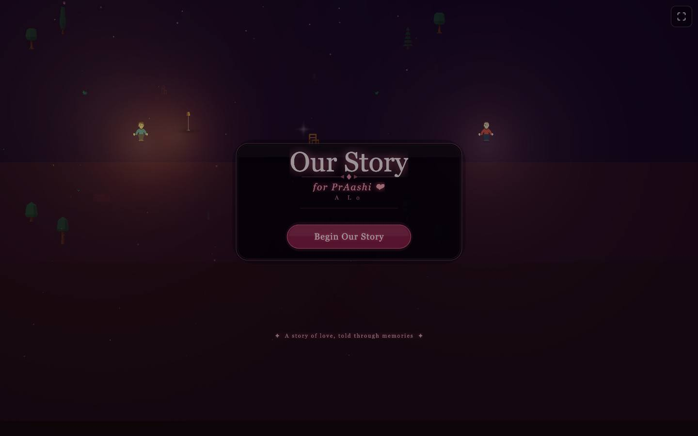
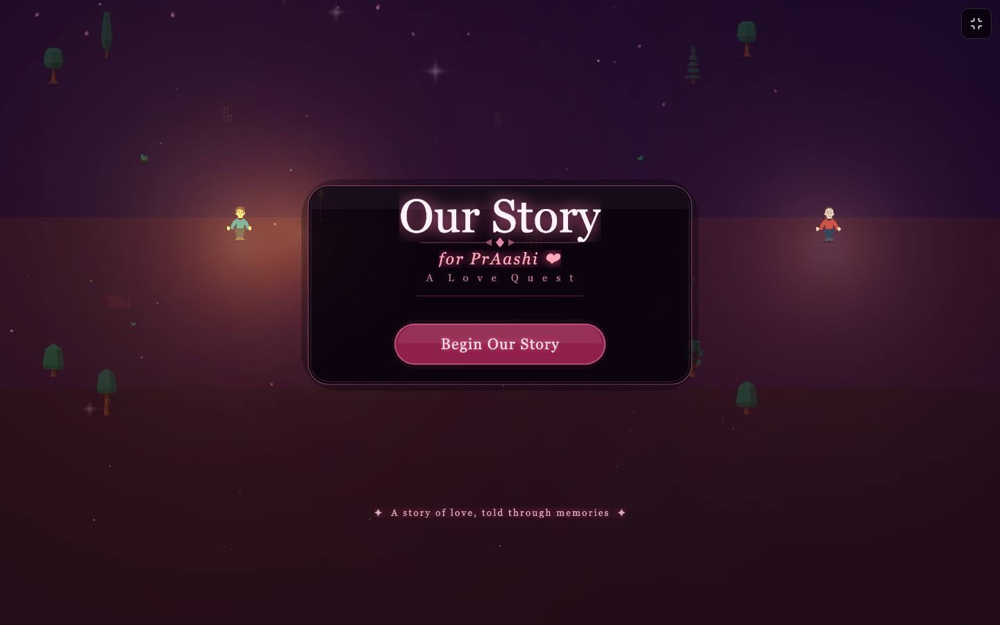
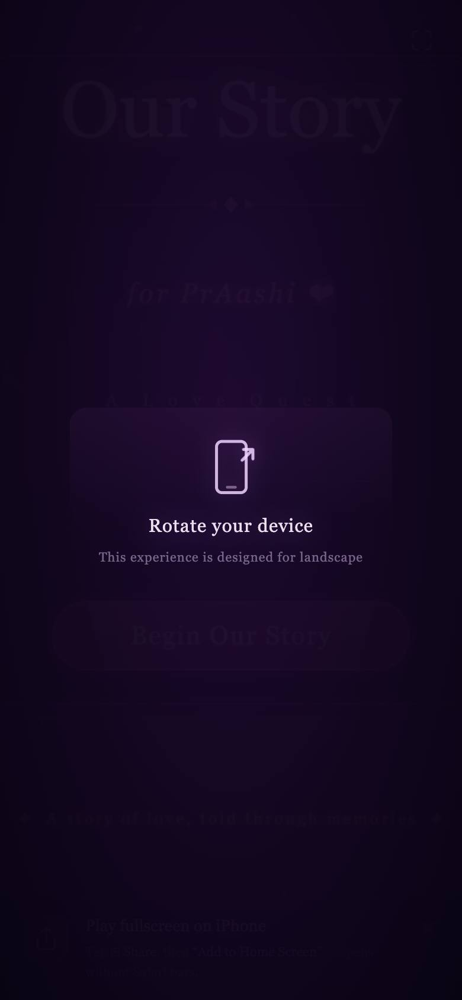

# Our Story: A Love Quest

> A story-driven 2D adventure game built with Phaser 3 — a playable walk through the chapters of a relationship, designed for landscape play.

**Live:** [praashi.fun](https://praashi.fun)

<p align="center">
  
  
  
</p>

## Built with

Phaser 3 · Vite · JavaScript

## Run locally

```bash
npm install
npm run dev
```

## License

Code is released under the [MIT License](LICENSE). Photos, video, artwork, audio and written content are not covered by it: personal media is © Prawal Sharma, all rights reserved, and third-party assets remain under their own licenses.
